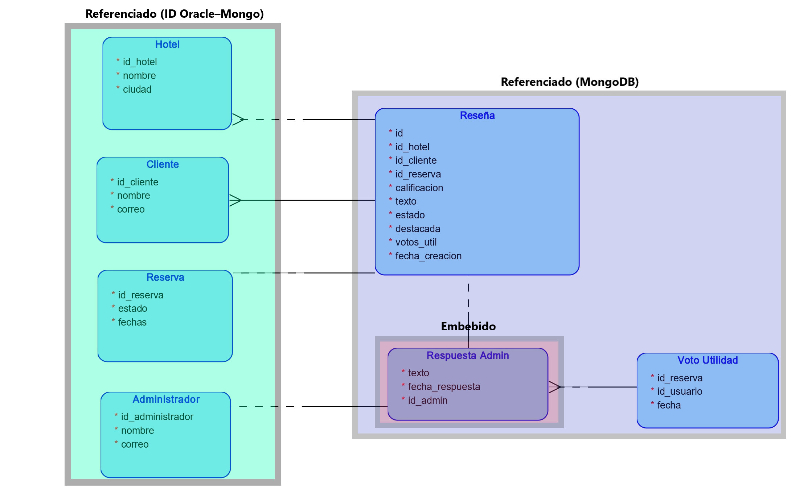

# Dann Alpes: Hybrid Oracle + MongoDB Hotel System


Guest-review module for the Dann Alpes hotel chain, designed as a **hybrid data architecture**: Oracle 19c keeps the master data (hotels, clients, reservations) and MongoDB stores the reviews, linked through shared identifiers. Includes the Oracle APEX application and the full set of MongoDB scripts.

Final project of *Database Fundamentals (ISIS1511)*, Universidad de los Andes, developed in a team of two.

---

## Why this project

Not all data fits the same database. Reservations are structured and transactional, so they belong in a relational model. Reviews are different: unpredictable volume, variable structure and reads that fetch many of them at once. Choosing the right engine for each kind of data, and keeping both consistent, is a real architecture decision companies face. This project was my first time making that decision with a documented workload analysis.

## Objectives

1. Analyze the workload of the review feature (operations, frequencies and joint access).
2. Design a NoSQL model deciding, relationship by relationship, between embedding and referencing.
3. Implement the collections with indexes and JSON Schema validation.
4. Answer the business questions with aggregation pipelines.

## Data model

| Relationship | Cardinality | Decision |
|---|---|---|
| Hotel to Review | 1 to N | Referenced (`id_hotel`, master data stays in Oracle) |
| Client to Review | 1 to N | Referenced (`id_cliente`) |
| Reservation to Review | 1 to 1 | Referenced, unique index on `id_reserva` |
| Review to Admin response | 1 to 1 | Embedded subdocument, always read together |
| Review to Helpful vote | 1 to N | Separate `votos_utilidad` collection with a denormalized counter on the review |
| User to Review (votes) | N to N | Resolved by `votos_utilidad` with a unique index per user and review |



## Implementation

- `01_crear_colecciones.js`: collections and compound indexes designed for the real query patterns (hotel + status + date, client + date, featured reviews, rating + date).
- `02_validacion_colecciones.js`: JSON Schema validation rules.
- `03_datos_prueba.js`: test data.
- `04_consultas_rfc.js`: aggregation pipelines for the analytical requirements:
  - **RFC1:** top 10 hotels by average rating.
  - **RFC2:** monthly reputation trend of a hotel during a year.
  - **RFC3:** comparative profile of the hotels in a city.
- `05_prueba_validacion.js`: tests showing that invalid documents are rejected.
- `dann_alpes_apex_app.sql`: export of the Oracle APEX application on top of the relational model.

## How to run

```bash
mongosh Scripts_MongoDB/01_crear_colecciones.js
mongosh Scripts_MongoDB/02_validacion_colecciones.js
mongosh Scripts_MongoDB/03_datos_prueba.js
mongosh Scripts_MongoDB/04_consultas_rfc.js
```

The APEX export is imported from the Oracle APEX workspace (App Builder, Import).

## What this project means for my development

This project taught me to think like a data architect: start from the workload, not from the technology, and justify every modeling decision. Polyglot persistence and indexing for real query patterns are skills I expect to use when designing enterprise and financial systems.

## Team

Tomás Alarcón and Daniel Galindo (team project).

---

**Author:** Tomás Alarcón, Systems and Computing Engineering, Universidad de los Andes
